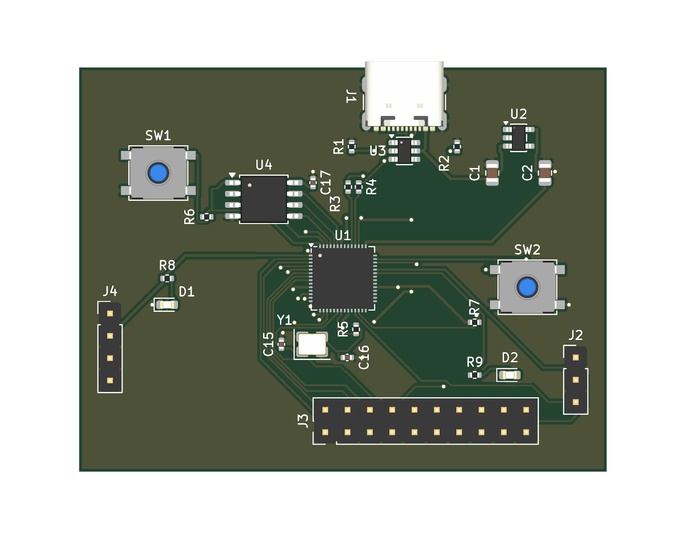

# boardwright

[](https://github.com/heibench/boardwright/actions/workflows/check.yml)
[](https://heibench.com/boardwright/)
[](https://pypi.org/project/boardwright/)
[](https://pypi.org/project/boardwright/)
[](LICENSE)

**Generate and edit KiCad boards and schematics from a short Python description,
checked by KiCad itself.**

> **Status: alpha.** It makes real, routed, DRC-clean KiCad 10 projects and edits
> existing ones in place. None of the example boards has been fabricated. The
> command line is the stable surface; the Python modules will move.

```sh
pip install boardwright             # add [live] to edit the board open in KiCad
boardwright doctor                  # what this machine has for each step
```

Needs KiCad 10 (its libraries and `kicad-cli`) and [Freerouting](https://github.com/freerouting/freerouting)
for autorouting. `boardwright doctor` finds them in the usual install places, Flatpak
included, and names the setting to use when it cannot.



## What it does

A board is a directory with a `board.py`: the circuit, where the parts go, and what
matters about the layout.

```python
from boardwright.circuit import Circuit

NAME, W, H = "ldo_breakout", 30, 20
CIRCUIT = c = Circuit("LDO breakout")
c.add("J1", "Connector_Generic:Conn_01x02", "VIN", "Connector_PinHeader_2.54mm:PinHeader_1x02_P2.54mm_Vertical", {1: "VIN", 2: "GND"})
c.add("U1", "Regulator_Linear:AMS1117-3.3", "AMS1117-3.3", "Package_TO_SOT_SMD:SOT-223-3_TabPin2", {1: "GND", 2: "+3V3", 3: "VIN"})
c.add("C1", "Device:C", "10u", "Capacitor_SMD:C_0805_2012Metric", {1: "VIN", 2: "GND"})
# ...
PLACE = {"J1": (3, 8.7, 0), "C1": (8.5, 10, 90), "U1": (15, 10, 270)}
REVIEW = {"near": [("C1.1", "U1.3", 6.0)]}      # input capacitor within 6 mm of the input pin
```

```sh
boardwright place examples/boards/ldo_breakout    # placement + ratsnest preview, ~5 s, no KiCad
boardwright gen examples/boards/ldo_breakout      # schematic, board, routing, pours
boardwright check examples/boards/ldo_breakout    # KiCad: ERC, DRC + parity, netlist, gerbers, plots
boardwright verify examples/boards/ldo_breakout   # PASS / NOT DONE
```

`verify` passes only when KiCad reports **zero** ERC and DRC findings at every
severity, schematic parity included, KiCad's netlist equals the declared circuit,
the fab files exist, and the engineering review is clean.

The review exists because a zero DRC is not a good board. An autorouter will run a
signal through a power polygon and leave the halves joined by a thin trace, and KiCad
accepts it. `REVIEW` checks what a reviewer would: decoupler-to-pin distance,
routed path lengths and pair matching (vias counted), how far a signal runs with no
ground on the adjacent layer, ground vias beside signal vias, pour coverage and
whether each pour is still one piece, and current capacity per IPC-2221.

**Boards that already exist** are edited in place and nothing is regenerated:

```sh
boardwright existing MYPROJ info              # layers, nets, pours, preview; any size of board
boardwright existing MYPROJ review            # the same review, against a spec beside the board
boardwright existing MYPROJ apply             # REMOVE, MOVE, RIPUP, ROUTES, TRACKS, VIAS, ZONES from the spec
boardwright existing MYPROJ reroute /SDA      # re-route named nets; every other net stays byte-identical
boardwright existing MYPROJ verify            # review + no DRC finding that is not in the baseline
boardwright sch MYPROJ set R12 Value=4k7      # one block of the schematic replaced, the rest untouched
boardwright live apply edit.py                # the same edits to the board open in KiCad, one undo step
```

## Exit codes

The same as the other [heibench](https://heibench.com/) tools, so a script or CI job can
branch on them:

| Code | Meaning |
|---|---|
| 0 | done: the board passed, or the edit was made |
| 1 | violated or refused: a finding about the design, or an edit not made |
| 2 | could not tell: a check could not be decided (a KiCad report is missing or stale) |
| 4 | environment fault: KiCad, a library or Freerouting missing or failing, or a file or folder it cannot read or write; never a verdict on the design |
| 64 | usage: bad arguments, or a spec naming parts, nets or layers that are not there |

## How it decides

- **KiCad is the judge.** Nothing is "done" on the tool's own arithmetic. Every
  generated board goes through `kicad-cli`, and edits to existing designs are compared
  against a baseline that KiCad produced. Connectivity before and after an edit is
  checked with [netspec](https://github.com/heibench/netspec).
- **Placement and hand copper are yours; the rest is routed.** Power loops, USB pairs and
  anything sensitive are drawn in `board.py` (`TRACKS`, `VIAS`, `ZONES`). Parts can be
  placed by intent: `pad_at(1, ("U1", 24), dy=-1.7)` puts a capacitor's pad 1.7 mm from
  pin 24. Freerouting does the remaining small signals, and a pad-to-pad router finishes
  what it leaves open.
- **Edits are plain data.** An edit to an existing board is an ordered list of
  operations in the board's own coordinates, checked against the board before it runs,
  so the same file can be applied to the file on disk or to KiCad's open board.

## Examples

`examples/boards/` has seven boards made with it; all but the library fixture follow a vendor
reference design:

| Board | Layers | What it exercises |
|---|---|---|
| `ldo_breakout` | 2 | the loop itself |
| `rp2040_min` | 2 | 0.4 mm QFN, USB-C, crystal, QSPI flash |
| `tps54202_buck` | 2 | a switching regulator's current loops, hand-routed power |
| `stm32f103_min` | 2 | 0.5 mm LQFP-48, bottom-side decoupling, USB pair |
| `esp32c3_min` | 2 | RF module with antenna keep-out, USB on the bottom layer |
| `stm32f103_4l` | 4 | inner ground planes, return-path and via review |
| `customlib_test` | 2 | parts from a library outside KiCad's stock set |

`examples/existing/` has specs for demo projects that ship with KiCad, for trying the
existing-board and schematic commands. [`docs/devlog/`](docs/devlog/) records what each
board broke in the tool and what was changed.

## Documentation

The site is at **https://heibench.com/boardwright/**. In this repository:

- [`docs/guide.md`](docs/guide.md): the full workflow, every `board.py` option, existing
  boards and schematics, the live KiCad client, and what the tool does badly.
- [`docs/devlog/gaps.md`](docs/devlog/gaps.md): known limits.
- [`skills/boardwright/SKILL.md`](skills/boardwright/SKILL.md): the agent skill, also
  installed with the package: `cd "$(boardwright --docs)"` and read
  `skills/boardwright/SKILL.md`.

## Known limits

- Freerouting is not repeatable on dense boards; the pad-to-pad router does not push
  other tracks aside, tune lengths or route pairs as pairs.
- Schematic editing changes fields, removes parts, and adds a part by copying one with
  the same symbol. It cannot add a symbol the sheet does not already use, and a
  schematic change is pushed to the board in KiCad.
- Generated schematics are one flat sheet.
- Impedance figures are closed-form (IPC-2141, about +-10 %); confirm with your fab.
- KiCad 10 only. The live client uses KiCad's IPC API, which is what KiCad 11 builds on.

## Development

```sh
just setup     # uv sync --all-extras
just check     # ruff
just test      # pytest; the full KiCad pipeline test skips where KiCad is absent
```

## License

Apache-2.0. The example boards are generated from KiCad's libraries, whose licence
(CC-BY-SA 4.0 with an exception for designs that use them) places no restriction on
the boards.
